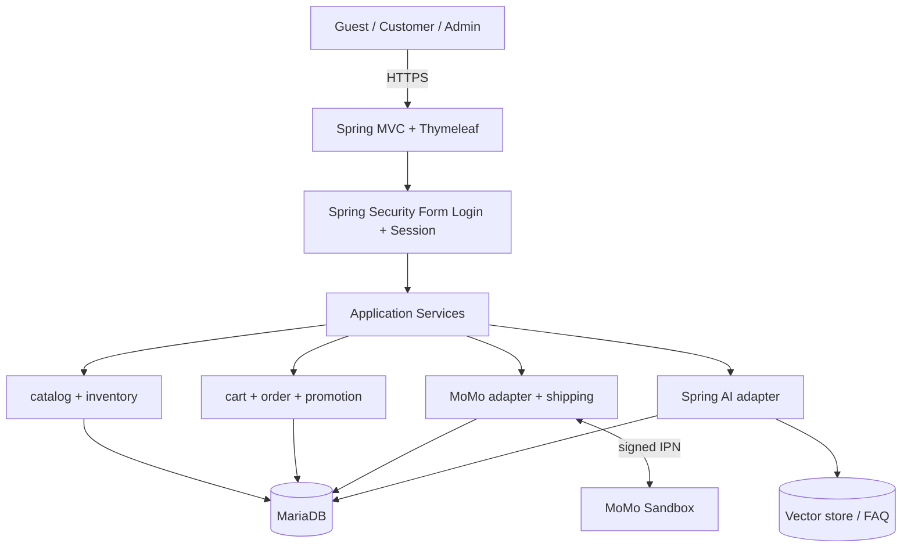

# Kiến trúc Spring Boot MVC

Sơ đồ mô tả các luồng mục tiêu của monolith. Xem [README](../../README.md) để biết các luồng đã kiểm thử.



- Ứng dụng đóng gói thành một JAR Spring Boot. Controller xử lý HTTP và Thymeleaf, service điều phối nghiệp vụ, repository truy cập dữ liệu qua JPA. Entity ánh xạ schema, DTO nhận hoặc trả dữ liệu ở biên ứng dụng.
- Cơ sở dữ liệu thống nhất MariaDB, với khóa ngoại và ràng buộc UNIQUE ở DB.
- Tránh vòng phụ thuộc: `order` gọi cổng `inventory`/`promotion`/`payment` qua service rõ ràng; các module không cập nhật bảng của nhau trực tiếp.
- Truy vấn sản phẩm cho chatbot: catalog SQL là nguồn sự thật; RAG chỉ cho nội dung mô tả/FAQ.
- Sử dụng `@Transactional` cho cập nhật đơn/tồn/voucher; **không** giữ transaction xuyên HTTP call tới cổng thanh toán.
- Frontend Thymeleaf và assets local; JS cho tương tác cần thiết. Không phải SPA React.

## Bố trí vật lý nguồn

```text
src/main/java/com/beautyshop/
  BeautyShopApplication.java
  controller/              # Trang công khai và controller/admin
  service/ repository/ entity/ dto/ security/
  domain/catalog/ inventory/ order/ shipping/
src/main/resources/
  templates/{home,product,auth,admin/catalog,fragments}/
  static/{css,js,img}/
  db/migration/
  ai-knowledge/
```

## Auth / quyền

- GUEST là anonymous; URL `/cart/**` dùng được cả guest, checkout/orders chỉ CUSTOMER, admin chỉ ADMIN.
- Form Login + `HttpSession`; không đưa JWT vào web. Cookie Session `HttpOnly`, `Secure` với HTTPS production.
- CSRF mặc định bật. **Chỉ** endpoint IPN đã được xác thực bằng HMAC mới cấu hình bỏ CSRF khi P07.
- Bắt buộc kiểm tra ownership ở service, không chỉ dựa `/orders/**` có ROLE_CUSTOMER.
