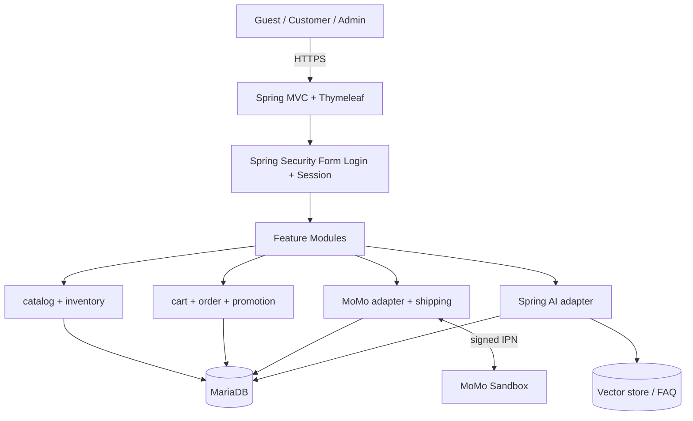

# Kiến trúc — Modular Monolith Spring Boot MVC



- Một JAR Spring Boot, không microservice. Code chia theo feature: `security`, `user`, `catalog`, `inventory`, `cart`, `order`, `payment`, `promotion`, `shipping`, `review`, `ai`, `admin`, `web`, `common`, `config`.
- Mỗi module có thể có `web`, `service`, `repository`, `entity`, `dto` khi cần; không tạo package rỗng vô nghĩa.
- Cơ sở dữ liệu thống nhất MariaDB, với khóa ngoại và ràng buộc UNIQUE ở DB.
- Tránh vòng phụ thuộc: `order` gọi cổng `inventory`/`promotion`/`payment` qua service rõ ràng; các module không cập nhật bảng của nhau trực tiếp.
- Truy vấn sản phẩm cho chatbot: catalog SQL là nguồn sự thật; RAG chỉ cho nội dung mô tả/FAQ.
- Sử dụng `@Transactional` cho cập nhật đơn/tồn/voucher; **không** giữ transaction xuyên HTTP call tới cổng thanh toán.
- Frontend Thymeleaf và assets local; JS cho tương tác cần thiết. Không phải SPA React.

## Bố trí vật lý nguồn

```text
src/main/java/com/beautyshop/
  BeautyShopApplication.java
  config/ common/ security/ user/ catalog/ inventory/ cart/
  order/ payment/ shipping/ promotion/ review/ ai/ admin/ web/
src/main/resources/
  templates/{home,product,cart,checkout,order,auth,admin,chat,fragments}/
  static/{css,js,img}/
  db/migration/
  ai-knowledge/
```

## Auth / quyền

- GUEST là anonymous; URL `/cart/**` dùng được cả guest, checkout/orders chỉ CUSTOMER, admin chỉ ADMIN.
- Form Login + `HttpSession`; không đưa JWT vào web. Cookie Session `HttpOnly`, `Secure` với HTTPS production.
- CSRF mặc định bật. **Chỉ** endpoint IPN đã được xác thực bằng HMAC mới cấu hình bỏ CSRF khi P07.
- Bắt buộc kiểm tra ownership ở service, không chỉ dựa `/orders/**` có ROLE_CUSTOMER.

## Trạng thái thực tế scaffold

`BeautyShopApplication`, `SecurityConfig`, trang home/products/login, 3 helper và unit test có sẵn. Business CRUD và tích hợp vẫn chưa triển khai; xem README và roadmap.
