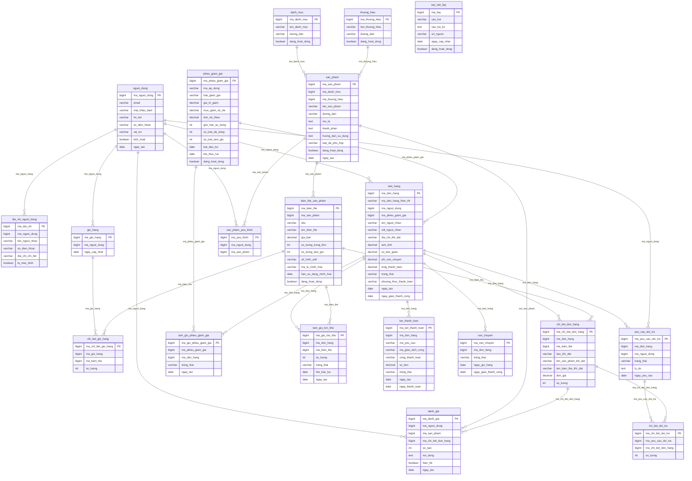

# ERD v5 – SQL tiếng Việt không dấu

Đây là sơ đồ ERD cho migration `V1__khoi_tao_co_so_du_lieu.sql`. Không dùng ERD v4 tiếng Anh làm nguồn tham chiếu nữa.

Chi tiết khóa ngoại, UNIQUE, CHECK xem trực tiếp SQL. Bảng và cột xem `docs/data/bang_doi_chieu_ten.csv`.

P02 bổ sung [V2](../../src/main/resources/db/migration/V2__ghi_nhan_tru_kho_cod.sql) với bảng `ghi_nhan_tru_kho_cod`. Khóa chính ghép `(ma_don_hang, ma_bien_the)` đồng thời tham chiếu `don_hang` và `bien_the_san_pham`. Cột `so_luong` ghi số lượng đã trừ cho lần COD để retry an toàn.

P04 bổ sung [V3](../../src/main/resources/db/migration/V3__ghi_nhan_gop_gio_hang.sql) với bảng `ghi_nhan_gop_gio_hang`. Khóa chính `ma_gop` là mã snapshot giỏ Guest và `ma_nguoi_dung` tham chiếu tài khoản nhận giỏ.

P04-OTP giữ trạng thái xác thực tạm trong HTTP session và Redis. Tài khoản chỉ được ghi vào `nguoi_dung` sau xác thực email. Schema MariaDB giữ nguyên.

P04-OAuth2 bổ sung [V6](../../src/main/resources/db/migration/V6__them_danh_tinh_oauth.sql). Cặp `nha_cung_cap_oauth` và `ma_danh_tinh_oauth` của `nguoi_dung` là duy nhất khi có giá trị. Tài khoản dùng mật khẩu có hai cột này rỗng.

P05 dùng khóa ngoại địa chỉ trong V1. [V4](../../src/main/resources/db/migration/V4__them_phien_ban_xac_thuc.sql) thêm `nguoi_dung.phien_ban_xac_thuc` để khóa tài khoản thu hồi phiên đăng nhập cũ.

P23 không đổi schema MariaDB. Nội dung đánh giá (sao, bình luận, trạng thái duyệt, phiên bản) lưu ở MongoDB, collection `danh_gia`, khóa duy nhất `maChiTietDonHang` (mã dòng đơn MariaDB). Điều kiện đánh giá BR16 vẫn kiểm trên các bảng MariaDB `chi_tiet_don_hang`, `don_hang` trước khi ghi. Bảng MariaDB `danh_gia` được giữ làm nguồn chuyển dữ liệu một lần và làm store dự phòng (`app.reviews.store=mariadb`). Khi store là `mongo`, app không ghi vào bảng này. Cấu trúc document và index xem [báo cáo P23](../reviews/P23-danh-gia-mongodb.md).
