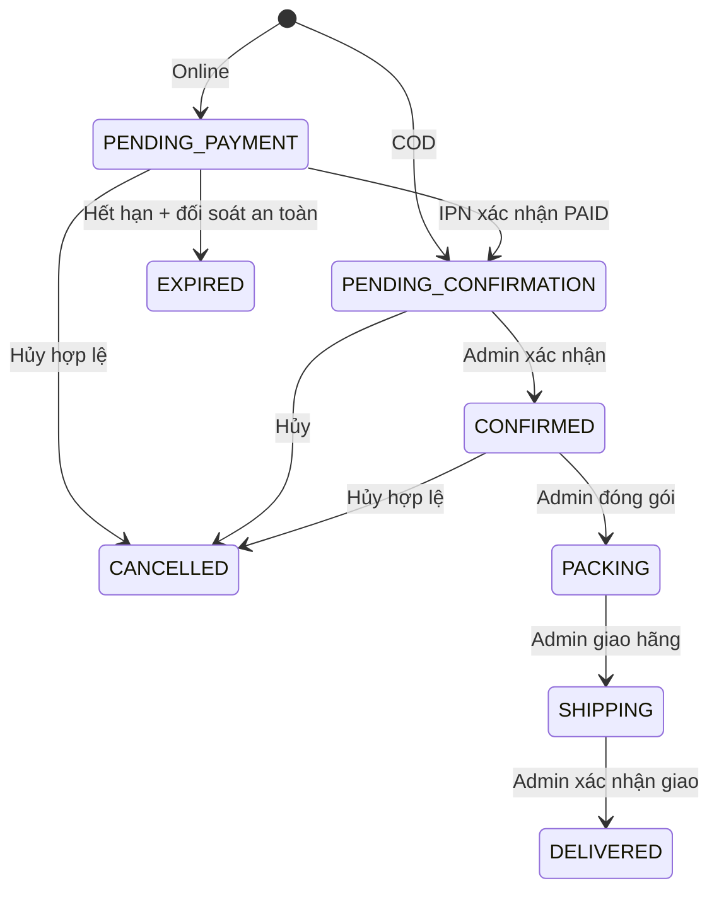

# State machine / thanh toán / kho / voucher

## 1. Order

Trạng thái `DELIVERED` hoàn tất luồng giao; ReturnRequest xử lý riêng, không thay Order thành REFUNDED. Có thể có yêu cầu hoàn tiền từ đơn `CANCELLED` đã PAID.

## 2. PaymentAttempt

`UNPAID` (COD) / `PENDING` (online) -> `PAID`, `FAILED`, `EXPIRED`; nếu thanh toán cần hoàn tiền: `REFUND_PENDING` -> `REFUNDED` sau xác minh. Một đơn có nhiều attempts nhưng chỉ được một thanh toán thành công được chấp nhận/ghi nhận; callback gửi lại phải idempotent. Với callback kết quả không rõ, phải thực hiện reconciliation trước hành động làm ảnh hưởng kho/voucher.

## 3. Inventory

`available = onHand - reserved`. Update dạng điều kiện nguyên tử hoặc row locking, trong transaction; ví dụ `UPDATE ... SET reserved=reserved+:qty WHERE id=? AND on_hand-reserved>=:qty`. Nếu update 0 row -> hết hàng/đã thay đổi, rollback toàn bộ checkout.

**Online:** reserve cả SKU + lượt voucher + tạo Order/Pending Payment ở DB -> commit -> gọi MoMo ngoài transaction; thành công xác thực -> onHand -= qty, reserved -= qty, voucher held->consumed, Order->PENDING_CONFIRMATION. Thất bại/hết hạn sau đối soát -> reserved -= qty, held voucher->released, Order->EXPIRED/CANCELLED.

**COD:** kiểm tra `available` và `onHand -= qty` trong transaction tạo Order; voucher tính/consume cùng transaction. Khi Customer/Admin hủy hợp lệ, cộng trả onHand và voucher một lần; không có reservation 15 phút.

Cần scheduler dọn những reservation quá hạn **chỉ khi được xác minh an toàn**, không chỉ nhìn `expiresAt`. Callback đến muộn sau khi đã RELEASED/EXPIRED phải ghi nhật ký sự cố/đối soát/hoàn tiền, **không trừ lại kho**.

### Contract P02 cho P06/P07

`TonKho_Service` có bốn phương thức trả `void`. Mã đơn và mã biến thể là `long`, số lượng là `int` dương.

| Phương thức | Đầu vào và hành vi |
|---|---|
| `reserveAtomically(maDonHang, maBienThe, soLuong)` | Đơn MOMO. Tạo giữ hàng `HELD` trong 15 phút theo UTC. Gọi lại với cùng số lượng khi còn `HELD` giữ nguyên số lượng và mốc hết hạn. |
| `consumeReservation(maDonHang, maBienThe)` | Chuyển `HELD` sang `CONSUMED` và giảm cả tồn trong kho lẫn tồn tạm giữ. Gọi lại khi đã `CONSUMED` giữ nguyên số liệu. P07 gọi sau khi xác minh thanh toán hoặc đối soát. |
| `releaseReservation(maDonHang, maBienThe)` | Chuyển `HELD` sang `RELEASED` và giảm tồn tạm giữ. Gọi lại khi đã `RELEASED` giữ nguyên số liệu. P07 gọi khi xác nhận an toàn để giải phóng. |
| `deductCOD(maDonHang, maBienThe, soLuong)` | Đơn COD. Giảm tồn khả dụng và ghi nhận một lần theo cặp đơn–SKU. Gọi lại với cùng số lượng giữ nguyên số liệu. |

Caller phải tạo và flush đơn trong cùng transaction trước khi gọi, gộp số lượng theo SKU và gọi theo mã biến thể tăng dần. Dịch vụ tham gia transaction hiện tại, khóa đơn rồi khóa và đọc lại biến thể. Khi thiếu tồn, SKU ngừng bán, lượng retry khác hoặc lượt giữ đã chốt theo hướng khác, phương thức ném lỗi để caller rollback toàn bộ checkout. Khi DB báo deadlock hoặc xung đột snapshot khi lấy khóa, retry toàn bộ transaction theo chính sách checkout. Trả hàng COD khi hủy hợp lệ thuộc P06. Scheduler, đối soát, IPN và voucher thuộc luồng tích hợp tiếp theo.

## 4. Voucher

- Chỉ một mã/đơn, `FIXED` hoặc `PERCENT`, giới hạn `usage_limit`, khung thời gian, minSpend, maxDiscount.
- Kiểm tra với subtotal trước chiết khấu, áp dụng giảm; phí ship dựa subtotal **sau** chiết khấu.
- Trước khi khách thanh toán online: giữ 1 lượt; khi PAID mới consume, hủy/hết hạn release. Sử dụng index & transaction để không vượt lượt.

## 5. MoMo

- Chỉ Sandbox; config thông tin merchant từ biến môi trường. Không đưa secret vào URL/log/HTML/repo.
- Chọn API/version MoMo cụ thể khi P07; HMAC ký đúng raw input theo tài liệu chính thức của version đó.
- Xác minh chữ ký IPN + attempt ref + order + amount + merchant + result/status; browser redirect KHÔNG là nguồn xác nhận thanh toán.
- Phải có endpoint HTTPS public để Sandbox gửi IPN, hoặc tunnel có truy cập công khai trong demo; không giả định `localhost` nhận được IPN.
- IPN là request bên ngoài không có browser CSRF token: chỉ exclude đường `/payment/momo/ipn`, nhưng bắt buộc xác thực signature và chống replay.

## 6. Policy hủy/đổi trả

Customer tự hủy khi Order trước `PACKING` và chưa bàn giao vận chuyển. Nếu PAID: cần trạng thái `REFUND_PENDING`, không được coi tiền đã trả lại. Yêu cầu đổi trả trong 7 ngày sau DELIVERED, admin quyết định và chỉ nhập kho khi đã nhận hàng phù hợp điều kiện.
