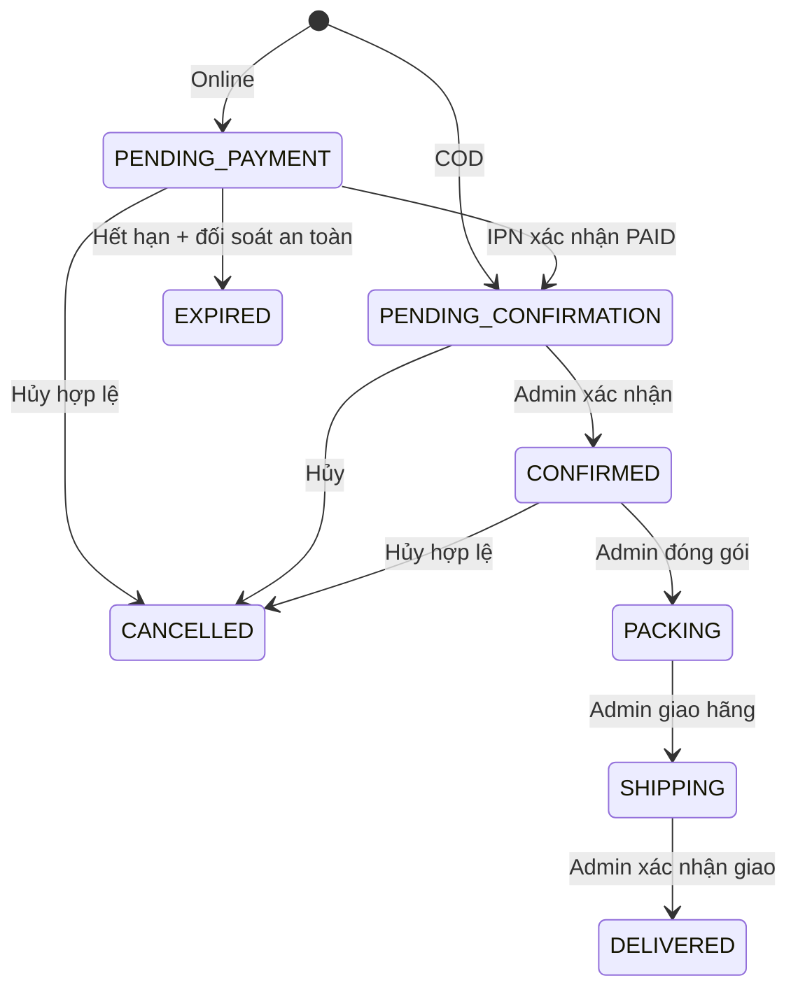

# State machine / thanh toán / kho / voucher

## 1. Order

Trạng thái `DELIVERED` hoàn tất luồng giao; ReturnRequest xử lý riêng, không thay Order thành REFUNDED. Có thể có yêu cầu hoàn tiền từ đơn `CANCELLED` đã PAID.

## 2. PaymentAttempt

`UNPAID` (COD) / `PENDING` (online) -> `PAID`, `FAILED`, `EXPIRED`; nếu thanh toán cần hoàn tiền: `REFUND_PENDING` -> `REFUNDED` sau xác minh. Một đơn có nhiều attempts nhưng chỉ được một thanh toán thành công được chấp nhận/ghi nhận; callback gửi lại phải idempotent. Với callback kết quả không rõ, phải thực hiện reconciliation trước hành động làm ảnh hưởng kho/voucher.

## 3. Inventory

`available = onHand - reserved`. Update dạng điều kiện nguyên tử hoặc row locking, trong transaction; ví dụ `UPDATE ... SET reserved=reserved+:qty WHERE id=? AND on_hand-reserved>=:qty`. Nếu update 0 row -> hết hàng/đã thay đổi, rollback toàn bộ checkout.

**Online:** reserve cả SKU + lượt voucher + tạo Order/Pending Payment ở DB -> commit -> gọi MoMo ngoài transaction; thành công xác thực -> onHand -= qty, reserved -= qty, voucher held->consumed, Order->PENDING_CONFIRMATION. Thất bại/hết hạn sau đối soát -> reserved -= qty, held voucher->released, Order->EXPIRED/CANCELLED.

**COD:** kiểm tra `available` và `onHand -= qty` trong transaction tạo Order; voucher tính/consume cùng transaction. Khi Customer/Admin hủy hợp lệ, cộng trả onHand và voucher một lần; không có reservation 15 phút.

Cần scheduler dọn những reservation quá hạn **chỉ khi được xác minh an toàn**, không chỉ nhìn `expiresAt`. Callback đến muộn sau khi đã RELEASED/EXPIRED phải ghi nhật ký sự cố/đối soát/hoàn tiền, **không trừ lại kho**.

### Contract P02 cho P06/P07

`TonKho_Service` có bốn phương thức trả `void`. Mã đơn và mã biến thể là `long`, số lượng là `int` dương.

| Phương thức | Đầu vào và hành vi |
|---|---|
| `reserveAtomically(maDonHang, maBienThe, soLuong)` | Đơn MOMO. Tạo giữ hàng `HELD` trong 15 phút theo UTC. Gọi lại với cùng số lượng khi còn `HELD` giữ nguyên số lượng và mốc hết hạn. |
| `consumeReservation(maDonHang, maBienThe)` | Chuyển `HELD` sang `CONSUMED` và giảm cả tồn trong kho lẫn tồn tạm giữ. Gọi lại khi đã `CONSUMED` giữ nguyên số liệu. P07 gọi sau khi xác minh thanh toán hoặc đối soát. |
| `releaseReservation(maDonHang, maBienThe)` | Chuyển `HELD` sang `RELEASED` và giảm tồn tạm giữ. Gọi lại khi đã `RELEASED` giữ nguyên số liệu. P07 gọi khi xác nhận an toàn để giải phóng. |
| `deductCOD(maDonHang, maBienThe, soLuong)` | Đơn COD. Giảm tồn khả dụng và ghi nhận một lần theo cặp đơn–SKU. Gọi lại với cùng số lượng giữ nguyên số liệu. |

Caller phải tạo và flush đơn trong cùng transaction trước khi gọi, gộp số lượng theo SKU và gọi theo mã biến thể tăng dần. Dịch vụ tham gia transaction hiện tại, khóa đơn rồi khóa và đọc lại biến thể. Khi thiếu tồn, SKU ngừng bán, lượng retry khác hoặc lượt giữ đã chốt theo hướng khác, phương thức ném lỗi để caller rollback toàn bộ checkout. Khi DB báo deadlock hoặc xung đột snapshot khi lấy khóa, retry toàn bộ transaction theo chính sách checkout. Trả hàng COD khi hủy hợp lệ thuộc P06. Scheduler, đối soát, IPN và voucher thuộc luồng tích hợp tiếp theo.

### Giỏ Guest và quyền sở hữu cho P06

- `GioKhach` lưu snapshot theo `maBienThe → soLuong` trong session. `GioHang_Service.gopSauDangNhap(maNguoiDung, gio)` ghi mã snapshot V3 và cập nhật giỏ DB trong cùng transaction. Cột tồn khả dụng hiện tại quyết định số lượng sau gộp. Giá hiển thị đọc từ SKU.
- `LoginSuccess_Handler` chỉ gộp cho Customer. Snapshot được bỏ khỏi session sau khi transaction thành công. Khi DB báo lỗi, session giữ snapshot để lần đăng nhập tiếp theo thử lại.
- P06 dùng lại `GioHang_Service` và hợp đồng khóa giỏ trước khi đổi số lượng. Checkout cần tính lại giá và khóa tồn khi lập đơn vì giỏ chưa giữ hàng.
- Khi tạo đơn từ địa chỉ đã lưu, P06 phải tìm địa chỉ theo cả mã địa chỉ và mã Customer đang đăng nhập, rồi lưu snapshot địa chỉ vào đơn.
- Trước khi đọc hoặc thao tác trên đơn của Customer, P06 gọi `QuyenDonHang_Service.kiemTraSoHuu(maDonHang)`. Service lấy mã người dùng từ phiên Security và trả 404 cho đơn không tồn tại hoặc thuộc người khác.

### Luồng COD P06

1. `DonHang_Service.datCOD` khóa giỏ rồi khóa SKU theo mã tăng dần để đọc giá/tồn hiện hành. Địa chỉ dùng bản ghi thuộc Customer. Nếu chọn voucher, khóa và kiểm tra lượt sau khi khóa SKU.
2. Lưu đơn, chi tiết và thanh toán COD `UNPAID`. Trừ tồn qua `TonKho_Service`, ghi nhận voucher và xóa các mục giỏ trong cùng transaction. Tính lại giá trên server ở lần đặt đơn. Báo giá tại `/checkout/quote` chỉ đọc giá và lượt hiện có.
3. Admin chuyển theo policy. Lúc bắt đầu giao, tạo bản ghi vận chuyển. Admin xác nhận đã giao và thu tiền để ghi `DELIVERED` và `PAID` cùng lúc, với timestamp UTC.
4. Hủy COD chỉ cho đơn chưa thu tiền, trước `PACKING`. Khóa đơn trước, trả tồn theo ghi nhận V2, hoàn lượt voucher rồi ghi `CANCELLED`. Retry một đơn đã hủy giữ nguyên số liệu.

P07 sử dụng contract giữ tồn 15 phút ở trên và phải giữ lượt voucher cùng transaction tạo đơn online. Gọi gateway ngoài transaction. Các route P06 phục vụ COD, dùng form session/CSRF. Quản trị tạo và sửa voucher thuộc P11.

### Tuần tự hóa với thay đổi catalog (BR21)

Checkout giữ khóa ghi mỗi SKU theo mã tăng dần và khóa đọc các hàng catalog cha khi đọc lại giá/tồn. Admin giữ khóa ghi trên hàng catalog đích trong `READ_COMMITTED` trước khi đếm đơn liên quan, gồm đơn mở và nghĩa vụ kho, thanh toán, voucher hoặc đổi trả chưa chốt. Truy vấn đếm dùng đọc thông thường. Hai hướng đều quyết định trên trạng thái mà giao dịch giữ khóa trước đã commit. Luồng xử lý đơn có sẵn giữ thứ tự khóa đơn rồi SKU.

## 4. Voucher

Quote và checkout dùng cùng policy của PhieuGiamGia_Service. Đọc giá SKU, xét phạm vi và Customer, giảm HÀNG trên tập đủ điều kiện, phân bổ tỷ trọng theo đồng rồi chia dư theo phần lẻ và ID SKU (mỗi SKU một dòng giỏ). Áp D27 sau giảm. Xét minSpend SHIP trên tiền hàng đúng phạm vi sau phân bổ, giảm tối đa bằng phí chuẩn. Khi phí 0, bỏ slot SHIP. Quote chỉ đọc.

Checkout khóa giỏ, SKU theo ID rồi phiếu theo ID. Khóa phiếu bảo vệ phạm vi và bộ đếm tổng, đồng thời tuần tự hóa phép đếm lượt HELD/CONSUMED của từng Customer. COD ghi hai chứng từ CONSUMED, xuất kho và snapshot trong một transaction. MoMo ghi HELD và giữ SKU 15 phút. Đối soát khóa đơn, xử lý SKU trước khi chuyển lượt theo ID phiếu. IPN lặp hoặc attempt cũ không tiêu hai lần. Khi còn giao dịch REFUND_PENDING, giữ tài nguyên đang chờ và chặn thử lại để tránh thu thêm tiền. Hủy COD chỉ trả CONSUMED khi chưa giao và UNPAID. Không có chuyển trạng thái lượt từ luồng hoàn sau giao.

Với ví dụ 520.000 ₫, giảm HÀNG 30.000 ₫, phí chuẩn 25.000 ₫, giảm SHIP 10.000 ₫, đơn và attempt cùng chốt 505.000 ₫. Tiền giao thực trả là 15.000 ₫. Xem snapshot lịch sử trực tiếp từ đơn. [Ví dụ đã duyệt](../reviews/VOUCHER-quyet-dinh-1-3.md)

Trang `/admin/vouchers` dành cho Admin. Mã được bỏ khoảng trắng hai đầu và viết hoa khi lưu. Voucher có hiệu lực từ thời điểm bắt đầu đến trước thời điểm kết thúc, theo UTC. Trường giới hạn phải đủ cho tổng lượt đã dùng và đang giữ. Lượt đã đặt và số tiền snapshot trên đơn được giữ khi Admin sửa hoặc ngừng voucher. Nếu còn đơn hoặc lịch sử giữ lượt tham chiếu thì dùng ngừng hoạt động. V9 mở rộng chứng từ giữ lượt của V1 sang hai slot.

## 5. MoMo

- Chỉ Sandbox; config thông tin merchant từ biến môi trường. Không đưa secret vào URL/log/HTML/repo.
- Chọn API/version MoMo cụ thể khi P07; HMAC ký đúng raw input theo tài liệu chính thức của version đó.
- Xác minh chữ ký IPN + attempt ref + order + amount + merchant + result/status; browser redirect KHÔNG là nguồn xác nhận thanh toán.
- Phải có endpoint HTTPS public để Sandbox gửi IPN, hoặc tunnel có truy cập công khai trong demo; không giả định `localhost` nhận được IPN.
- IPN là request bên ngoài không có browser CSRF token: chỉ exclude đường `/payment/momo/ipn`, nhưng bắt buộc xác thực signature và chống replay.

## 6. Policy hủy/đổi trả

Customer tự hủy khi Order trước `PACKING` và chưa bàn giao vận chuyển. Nếu PAID: cần trạng thái `REFUND_PENDING`, không được coi tiền đã trả lại. Yêu cầu đổi trả trong 7 ngày sau DELIVERED, admin quyết định và chỉ nhập kho khi đã nhận hàng phù hợp điều kiện.

Trong P08, Customer gửi một yêu cầu gồm một hoặc nhiều dòng của chính đơn đã giao. Hệ thống dùng giờ UTC của MariaDB để kiểm cửa sổ 7 ngày và khóa hàng đơn khi kiểm số lượng còn có thể yêu cầu. Admin xử lý `PENDING → APPROVED → RECEIVED → COMPLETED` hoặc `PENDING → REJECTED`. Mọi yêu cầu trừ `REJECTED` đều tính vào số lượng đã yêu cầu. Trang đổi trả chỉ thao tác trạng thái yêu cầu. Tiếp nhận hàng, điều chỉnh tồn và hoàn tiền cần quy trình vận hành riêng.

## Transaction nhập trả theo kiện

Admin giữ khóa người thao tác, đơn, hồ sơ trả và khóa các SKU theo ID tăng dần khi xác nhận. Mọi lệnh ghi kiểm quyền, phiên, UUID và version. Tồn bán chỉ tăng khi toàn kiện đã có kết luận và các SKU được nhập vẫn được phép bán. Một transaction ghi phiếu nhập theo từng dòng nhận dương, cập nhật tồn, xác nhận kiện và ghi audit SUCCESS. Nếu rollback, FAILED được ghi riêng. Đơn đã giao, lượt hai voucher, reservation và lịch sử thanh toán tiếp tục là chứng từ gốc.

Giờ gửi yêu cầu vẫn theo BR17. Không áp thời hạn này cho kiện đã duyệt. Khi nguồn DB báo chờ tiền/đối soát, có reservation HELD hoặc chưa có chứng từ thanh toán phù hợp, hồ sơ tiếp tục mở. Admin đối chiếu chứng từ ngoài hệ thống trước khi ghi mã đóng hồ sơ. Dòng còn thiếu lấy theo lượng duyệt trừ thực nhận tại lúc đóng, phần này phải có chứng từ giải quyết. D29 tiếp tục tính toàn lượng yêu cầu của hồ sơ COMPLETED. [Quyết định RETURN](../DECISIONS.md#return--quyết-định-owner-ngày-28112026)
