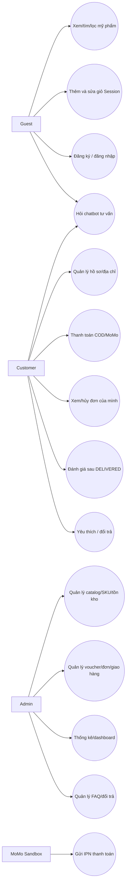

# Use case v1.0

**Lưu ý UML:** Biểu đồ Mermaid ở trên là bản phác thảo actor–use case, không thay thế Use Case Diagram UML chuẩn cho tài liệu chấm điểm. Nhóm cần vẽ lại bằng PlantUML/UML, có system boundary và include/extend khi thích hợp, sau khi chốt use case đặc tả.

## Các use case quan trọng cần đặc tả chi tiết

- UC-01 Guest xem/đặt vào giỏ: thêm SKU; session giữ số lượng; không khóa kho lúc thêm.
- UC-02 Đăng nhập checkout: phải merge giỏ idempotent, sau đó vào checkout.
- UC-03 Checkout COD: kiểm tra customer/variant/available/voucher/ship, transaction tạo order và trừ kho.
- UC-04 Checkout MoMo: giữ kho/lượt voucher và tạo pending, gọi payment gateway, ghi nhận IPN an toàn.
- UC-05 Admin chuyển trạng thái đơn: role & state policy, log chuyển trạng thái.
- UC-06 Đánh giá: kiểm tra ownership của order_item đã giao.
- UC-07 Đổi trả: trước hạn 7 ngày, admin duyệt và không auto hoàn kho.
- UC-08 RAG: truy xuất kiến thức nguồn đáng tin, không chạm thông tin khách khác.
