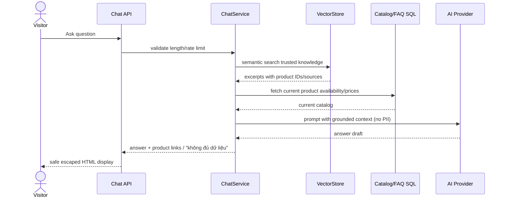

# Sequence diagrams — luồng quan trọng

## Checkout online

```mermaid
sequenceDiagram
  actor Customer
  participant Web as Thymeleaf/Controller
  participant Order as OrderService
  participant Inv as InventoryService
  participant Promo as VoucherService
  participant DB as MariaDB
  participant Gateway as MoMo Sandbox
  Customer->>Web: POST /checkout (sku/qty/voucher)
  Web->>Order: placeOrder(customer, request)
  Order->>DB: transaction begins; validate snapshots
  Order->>Inv: reserveAtomically(sku, qty, 15m)
  Inv-->>Order: held / failure
  Order->>Promo: holdUsageIfEligible(code)
  Promo-->>Order: held / failure
  Order->>DB: save PENDING_PAYMENT / reservations; commit
  Order->>Gateway: create payment (outside DB transaction)
  Gateway-->>Customer: Redirect payment page
  Gateway->>Web: POST signed IPN
  Web->>Order: verify HMAC + amount + attempt + idempotency
  Order->>DB: consume reservation, mark PAID once (transaction)
  Web-->>Gateway: IPN acknowledgment
```

## COD checkout

```mermaid
sequenceDiagram
 actor Customer
 participant Web as CheckoutController
 participant Order as OrderService
 participant DB as MariaDB
 Customer->>Web: POST COD checkout
 Web->>Order: validate and placeCODOrder()
 Order->>DB: transaction: check available; decrement on_hand; consume voucher; snapshot order
 DB-->>Order: commit
 Order-->>Web: order code
 Web-->>Customer: redirect order detail
```

## RAG chatbot


