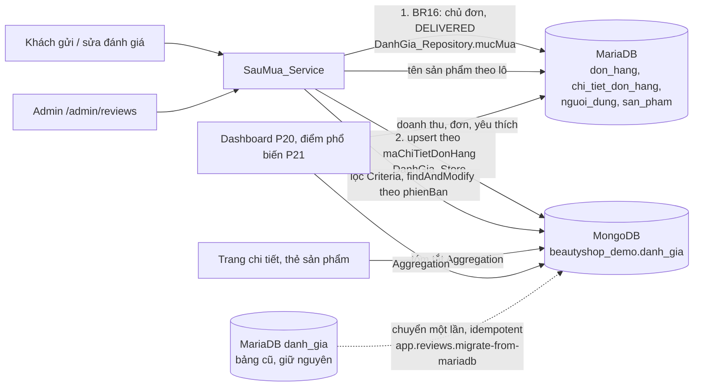

# P23 — Đánh giá sao và bình luận lưu ở MongoDB

Ngày 24/11/2026. Trạng thái: hoàn tất, đang chờ owner xem lại. **Chưa commit, chưa push.**

## 1. Kết quả chính

- Nội dung đánh giá (số sao 1–5, bình luận tối đa 1.000 ký tự, trạng thái duyệt, phiên bản) lưu ở MongoDB 6.0.8, collection `danh_gia` trong database `beautyshop_demo`.
- MariaDB vẫn là nguồn sự thật cho điều kiện BR16: đúng chủ đơn, đơn `DELIVERED`, mỗi `ma_chi_tiet_don_hang` một đánh giá. Không đổi schema MariaDB, không thêm migration Flyway.
- Mọi nơi dùng đánh giá đều đi qua interface `DanhGia_Store`: trang chi tiết, thẻ sản phẩm, form khách, trang Admin, Dashboard P20 và điểm phổ biến P21. Có hai bản cài đặt: `MongoDanhGia_Store` (mặc định) và `MariaDbDanhGia_Store` (dự phòng, `app.reviews.store=mariadb`).
- Chuyển 71 đánh giá demo từ MariaDB sang MongoDB. Chạy lần hai không nhân đôi (ghi 0, bỏ qua 71).
- MongoDB tắt thì app vẫn khởi động. Trang chủ, `/products`, giỏ hàng và checkout vẫn chạy. Trang chi tiết báo "Tạm thời chưa tải được đánh giá". Sau lỗi đầu tiên, store nghỉ 15 s nên các trang sau không phải chờ timeout.
- `seed-demo-orders.ps1` thêm 30 lượt yêu thích demo, idempotent, không đổi schema.

## 2. Vai trò hai cơ sở dữ liệu



Thứ tự ghi:

1. Kiểm BR16 ở MariaDB trước (`SauMua_Service.java:166`).
2. Kiểm số sao và độ dài nội dung.
3. Ghi một lệnh vào MongoDB (`SauMua_Service.java:131`, `:136`).

Vì chỉ có một lệnh ghi nên không có ghi nửa vời giữa hai DB. Nếu MongoDB lỗi, form giữ nguyên nội dung và báo "Tạm thời chưa lưu được đánh giá…" (`SauMua_Controller.java:56–58`).

## 3. Document và index

Collection `danh_gia` (`entity/DanhGia_Document.java`):

| Trường | Kiểu | Ghi chú |
|---|---|---|
| `_id` | ObjectId | Admin dùng làm mã đánh giá trên URL (`/admin/reviews/{id}/visibility`). |
| `maChiTietDonHang` | Long | **Unique.** Khóa nghiệp vụ, mỗi dòng đơn một đánh giá. |
| `maDonHang`, `maNguoiDung`, `maSanPham`, `maBienThe` | Long | Lấy từ MariaDB lúc kiểm BR16. |
| `tenHienThi` | String | Tên rút gọn, ví dụ "Thịnh P." (`DanhGia_Store.java:141`). Không lưu email hay số điện thoại. |
| `soSao` | Integer | 1–5. |
| `noiDung` | String | Đã bỏ khoảng trắng hai đầu, tối đa 1.000 ký tự (form + service). |
| `hienThi` | Boolean | Tạo mới và sửa: `false` (chờ duyệt). |
| `ngayDuyet` | Date | Có giá trị = đã từng duyệt. Phân biệt **chờ duyệt** (`hienThi=false`, không có `ngayDuyet`) với **đã ẩn**. |
| `phienBan` | Long `@Version` | Khóa lạc quan. Tạo mới = 0; mỗi thay đổi tăng 1 (khách sửa, Admin duyệt hoặc ẩn). Admin chỉ duyệt đúng phiên bản đã xem. |
| `ngayTao`, `ngayCapNhat` | Date (Instant, UTC) | Hiển thị theo giờ Việt Nam (`DanhGia_Store.java:136`). |

Index được tạo khi app khởi động (`MongoDanhGia_Store.java:72–83`). Lỗi được bắt và ghi log; MongoDB tắt thì app vẫn chạy.

| Tên | Khóa | Dùng cho |
|---|---|---|
| `uq_ma_chi_tiet_don_hang` (unique) | `{maChiTietDonHang: 1}` | Chặn trùng, kể cả khi ghi thẳng bỏ qua store (đã test). |
| `idx_san_pham_hien_thi_ngay` | `{maSanPham: 1, hienThi: 1, ngayTao: -1}` | Danh sách công khai theo sản phẩm; tóm tắt nhiều sản phẩm. |
| `idx_nguoi_dung` | `{maNguoiDung: 1}` | Tra đánh giá của khách. |
| `idx_hien_thi_ngay` | `{hienThi: 1, ngayTao: -1}` | Admin lọc trạng thái; tóm tắt toàn cửa hàng. |

## 4. Kỹ thuật Spring Data MongoDB và vị trí trong mã

| Kỹ thuật | Vị trí | Ghi chú |
|---|---|---|
| Starter `spring-boot-starter-data-mongodb` | `pom.xml:34` | Spring Data MongoDB 4.5.x theo Boot 3.5.16. Tải online một lần (owner đồng ý), sau đó chạy `mvn -o`. |
| Cấu hình URI qua biến môi trường | `application.properties:22–25`, `.env.example` | `MONGODB_URI`, `REVIEWS_STORE`, `REVIEWS_MIGRATE_FROM_MARIADB`. |
| Timeout ngắn (`MongoClientSettingsBuilderCustomizer`) | `review/MongoDanhGia_Config.java:19–23` | Chọn server 2 s, kết nối 2 s, đọc 5 s. |
| `@Document`, `@Id`, `@Indexed(unique)`, `@CompoundIndex`, `@Version` | `entity/DanhGia_Document.java:16–19, 25, 28, 31, 48` | |
| Tạo index bằng `IndexOperations` + `MongoPersistentEntityIndexResolver` | `repository/MongoDanhGia_Store.java:75–78` | Chạy ở `ApplicationReadyEvent`, bọc try/catch. |
| `MongoRepository` + derived query | `repository/DanhGiaMongo_Repository.java:10–15` | `findByMaChiTietDonHangAndMaNguoiDung`, `findByMaSanPhamAndHienThiTrueOrderByNgayTaoDesc(…, Pageable)`, `countByHienThiFalseAndNgayDuyetIsNull`. |
| `MongoTemplate.upsert` + `$setOnInsert` (tạo không đè) | `MongoDanhGia_Store.java:93–106`; `review/ChuyenDanhGiaSangMongo_Runner.java:80` | `getUpsertedId()==null` → `DuplicateKeyException` → HTTP 409. |
| `findAndModify` + `Criteria` theo `_id` + `phienBan` | `MongoDanhGia_Store.java:115, 157–170` | Sửa: theo chủ sở hữu, `$inc phienBan`. Duyệt: chỉ khớp đúng phiên bản Admin đã xem. |
| `Criteria`/`Query` động + phân trang (`PageableExecutionUtils`) | `MongoDanhGia_Store.java:127–145` | Admin lọc trạng thái, số sao, sản phẩm. |
| Aggregation match → group → project | `MongoDanhGia_Store.java:183–186` (nhiều sản phẩm), `:198–201` (toàn cửa hàng), `:210–213` (Dashboard) | `count`, `sum`, `avg`, phân bố 1–5 bằng `ConditionalOperators.when(...)` (`:229`). |
| Không ghép chuỗi JSON từ dữ liệu người dùng | Toàn bộ store dùng `Criteria`/`Update`/tham số có kiểu | Mã đánh giá kiểm bằng `ObjectId.isValid` trước khi truy vấn. Phiên bản phải là số (service kiểm `[A-Za-z0-9]{1,64}`). |
| Chọn bản cài đặt bằng `@ConditionalOnProperty` | `MongoDanhGia_Store.java:50`, `MariaDbDanhGia_Store.java:25`, runner `:29` | |
| Ngắt mạch khi MongoDB lỗi | `MongoDanhGia_Store.java:248–258` | Nghỉ 15 s sau `DataAccessResourceFailureException`. |

Các nơi gọi interface:

- Trang chi tiết: `SauMua_Service.java:62`.
- Thẻ sản phẩm: một truy vấn cho cả trang, không N+1 (`SauMua_Service.java:73`, `CuaHang_Controller.java:46`, `Bootstrap_Controller.java:79`).
- Dashboard: `ThongKe_Service.java:65–67`.
- Điểm phổ biến: `GoiYPhoBien_Service.java:78–79`.

## 5. Giao diện

- **Trang chi tiết** (`product/detail.html:78–113`):
  - Điểm trung bình (số + sao, chữ cho trình đọc màn hình "4,5 trên 5 sao") và tổng số đánh giá.
  - Thanh phân bố 5→1 dùng `<progress>`.
  - Danh sách phân trang 10/trang (`reviewPage`, giữ biến thể đang chọn, neo `#danh-gia`), mỗi mục gồm tên rút gọn, ngày, sao và nhãn "Đã mua hàng". Nội dung dùng `th:text`.
- **Fragment sao dùng chung**: `fragments/rating.html`, có nửa sao.
- **Form khách** (`order/review.html`):
  - Giữ route cũ.
  - Nhóm 5 radio có `legend`, mỗi sao có nhãn ẩn "n sao". Dùng được bằng phím mũi tên và vẫn chạy khi tắt JS.
  - Bộ đếm ký tự: số đếm render từ server, `static/js/review-form.js` cập nhật khi gõ (không có script inline). Có `maxlength` 1.000.
  - Khi MongoDB lỗi, hiện thông báo `loiLuu`.
- **Thẻ sản phẩm** (`fragments/product-card.html:25`): sao trung bình và số đánh giá, an toàn khi thiếu dữ liệu.
- **Admin** (`admin/user/reviews.html`):
  - Lọc GET theo trạng thái (Tất cả, Chờ duyệt, Đang hiện, Đã ẩn), số sao và sản phẩm. Bộ lọc không hợp lệ quay về mặc định.
  - Phân trang 20/trang, giữ bộ lọc.
  - Tên sản phẩm lấy từ MariaDB theo lô.
  - Duyệt gửi `revision` (phiên bản đã xem). Ẩn không cần phiên bản.
- **CSS** cuối `static/css/storefront.css`: dùng token màu (Dark Luxury), có `forced-colors`. Ở 390 px không có cuộn ngang (đã kiểm).

## 6. Chuyển dữ liệu MariaDB → MongoDB

`review/ChuyenDanhGiaSangMongo_Runner.java` chỉ chạy khi `app.reviews.migrate-from-mariadb=true`:

- Upsert theo `maChiTietDonHang`, chỉ dùng `$setOnInsert`. Document đã có (kể cả khách đã sửa hoặc Admin đã duyệt sau lần chuyển trước) không bị đè.
- Đánh giá đang hiện được gán `ngayDuyet = ngayTao`, để Admin thấy "Đang hiện" chứ không phải "Chờ duyệt".
- Số sao ngoài khoảng 1–5 hoặc thiếu ngày được đếm là "không hợp lệ" và bỏ qua.

Kết quả trên `beautyshop_demo` (log: `docs/qa/P23/migrate-log.txt`):

| Lần | Đọc | Ghi | Đã có | Không hợp lệ |
|---|---|---|---|---|
| 1 | 71 | 71 | 0 | 0 |
| 2 | 71 | 0 | 71 | 0 |

Đối chiếu dữ liệu (`docs/qa/P23/migrate-source-mariadb.txt` và `migrate-result-mongo.txt`):

| | MariaDB `danh_gia` | MongoDB `danh_gia` |
|---|---|---|
| Tổng | 71 | 71 (0 trùng `maChiTietDonHang`) |
| Đang hiện | 64 | 64 (64 có `ngayDuyet`) |
| 5/4/3/2/1 sao (tổng; đang hiện) | 21;19 · 25;21 · 8;8 · 9;9 · 8;7 | giống hệt |
| Trung bình sao (mọi bản) | 3,592 | 3,592 |
| Số sản phẩm | 26 | 26 |

Sau khi chuyển, báo cáo điểm phổ biến P21 (`docs/qa/P23/popular-scores-demo.txt`) có m = 3,5625. Giá trị này đúng bằng trung bình của 64 đánh giá đang hiện (228/64), đọc từ MongoDB. Top 5 trang chủ: r026, r001, r009, r021, r029. r001 lên hạng 2 nhờ 4 lượt yêu thích demo mới.

Khi store là `mongo`, bảng MariaDB `danh_gia` không còn được ghi (D32 trong `docs/DECISIONS.md`). `seed-demo-orders.ps1` vẫn ghi đánh giá demo vào MariaDB như trước. Quy trình demo: seed, rồi chạy app một lần với cờ chuyển dữ liệu (`docs/deployment/07-mongodb-danh-gia.md`).

## 7. Lượt yêu thích demo

`Add-DemoWishlists` trong `scripts/seed-demo-orders.ps1`:

- Chọn 30 cặp (khách demo, sản phẩm demo) tất định theo `-Seed`, lệch về các sản phẩm đầu danh sách.
- Mỗi cặp dùng `INSERT … WHERE NOT EXISTS`.
- Chạy cả khi đơn demo đã có (trước `return`) và ở cuối script.

Kết quả (`docs/qa/P23/seed-wishlist.txt`):

| Thời điểm | Số dòng |
|---|---|
| Trước khi chạy | 0 |
| Sau lần 1 | 30 |
| Sau lần 2 | 30 |

## 8. Kiểm thử (JDK 21, `mvn -o`)

| Lệnh | Kết quả | Bằng chứng |
|---|---|---|
| `mvn -o test` (không cờ; lần cuối, sau mọi sửa đổi) | 250 test, 0 lỗi, 48 bỏ qua (test cần MariaDB/MongoDB thật), 31,6 s | `docs/qa/P23/mvn-test-full.txt` |
| `P01_MARIADB_TEST=true mvn -o test` trên DB trống `beautyshop_p23_it`, **MongoDB tắt** | 251 test, 0 lỗi, 10 bỏ qua. `MongoTat_MariaDb_Test` đạt. DB đã xóa | `docs/qa/P23/mvn-test-mariadb-mongo-tat.txt` |
| `P23_MONGO_TEST=true mvn -o test -Dtest=MongoDanhGia_Store_Test,…` | 14 test, 0 lỗi | `docs/qa/P23/mvn-test-mongo-store.txt` |
| `P01_MARIADB_TEST=true P23_MONGO_TEST=true mvn -o test` trên DB trống mới | **251 test, 0 lỗi, 1 bỏ qua** (báo cáo demo). DB đã xóa | `docs/qa/P23/mvn-test-mariadb-mongo.txt` |
| `P21_DEMO_REPORT=true mvn -o test -Dtest=GoiYPhoBienDemoReport_Test` (chỉ đọc, demo) | Đạt | `docs/qa/P23/mvn-popular-report.txt` |
| `mvn -o -DskipTests package` | BUILD SUCCESS | `docs/qa/P23/mvn-package.txt` |

Test mới hoặc sửa theo yêu cầu P23:

- `SauMuaDanhGiaServiceTest` (unit, store giả trong bộ nhớ, 7 test):
  - BR16: đủ điều kiện thì tạo chờ duyệt; chưa giao hoặc không phải chủ đơn thì không gọi store.
  - Mỗi dòng đơn một đánh giá.
  - Sửa thì ẩn chờ duyệt lại; Admin duyệt bằng phiên bản cũ bị từ chối.
  - Phiên bản không hợp lệ bị chặn trước khi gọi store.
  - Nội dung 1.001 ký tự bị chặn, đúng 1.000 thì qua; số sao ngoài 1–5 bị chặn.
  - Store lỗi thì trang chi tiết và thẻ sản phẩm vẫn chạy, có cờ báo.
- `MongoDanhGia_Store_Test` (MongoDB thật, `P23_MONGO_TEST`, database `beautyshop_test_mongo`, xóa collection trước mỗi test):
  - Có đủ 4 index; index unique chặn trùng qua store và cả khi `insert` thẳng.
  - Aggregation: trung bình, phân bố, lọc theo ngày, tóm tắt toàn cửa hàng, thống kê Dashboard.
  - `findAndModify` theo phiên bản; lọc chờ duyệt, đang hiện, đã ẩn.
  - Phân trang Admin và công khai.
  - Chuyển dữ liệu hai lần không nhân đôi, không đè bản khách đã sửa.
- `MongoDanhGiaStoreNghiTest` (unit): ngắt mạch 15 s; mã không phải ObjectId thì không gọi MongoDB.
- `MongoTat_MariaDb_Test`: URI trỏ tới cổng không có MongoDB.
  - Chi tiết sản phẩm trả 200 kèm thông báo; trang chủ, `/products`, `/cart` trả 200.
  - Lần đầu < 6 s; các trang sau < 1,5 s (fail-fast).
- `SauMua_MongoDanhGia_Test`: chạy lại toàn bộ kịch bản sau mua của `SauMua_MariaDb_Test` với store `mongo`, trên MariaDB thật và MongoDB thật. Bản MariaDB của kịch bản này giờ chạy store `mariadb`, tức là test luôn cả bản dự phòng.
- `DanhGiaPagesTest`, `AdminDanhGiaPagesTest` (MVC):
  - Form có 5 radio và nhãn, giới hạn 1.000, bộ đếm; form sửa chọn sẵn số sao.
  - Lỗi kho thân thiện, giữ nội dung.
  - Admin lọc, phân trang, gửi `revision`; bộ lọc độc hại quay về mặc định; CSRF và vai trò.
- `GiaoDienPagesTest`: tóm tắt và danh sách trên trang chi tiết, ngày theo giờ Việt Nam, phân trang giữ biến thể, thông báo khi kho lỗi, sao trên thẻ chỉ một truy vấn tóm tắt.
- Cập nhật theo API mới: `ThongKeServiceTest`, `GoiYPhoBienServiceTest`, `GoiYSanPham_MariaDb_Test`, `AdminDashboardPagesTest`, `AdminServiceMethodSecurityTest`, `GoiYPhoBienDemoReport_Test` (đọc MongoDB demo).

Cách chạy lại:

```powershell
mvn -o test
$env:P23_MONGO_TEST = 'true'; mvn -o test -Dtest='MongoDanhGia_Store_Test'
# Đủ bộ: tạo DB trống, đặt DB_URL tới DB đó, P01_MARIADB_TEST=true, P23_MONGO_TEST=true, mvn -o test, rồi xóa DB.
```

## 9. QA trên trình duyệt

Harness: `docs/qa/P23/danh-gia.qa.mjs` (Chrome qua DevTools protocol, không dùng npm). App là jar mới, chạy ở cổng 8081 với `-Xmx512m` trên `beautyshop_demo`. App đã dừng sau QA; service MongoDB vẫn chạy.

### 9.1 MongoDB tắt (service dừng)

`docs/qa/P23/qa-browser-mongo-off.txt`, `results-mongo-off.json`. Kết quả: **10/10 đạt**, 0 lỗi JS.

- App khởi động bình thường. Tạo index lỗi chỉ ghi WARN (`docs/qa/P23/app-mongo-off.txt`).
- Thời gian phía server (Guest), theo thứ tự gọi:

  | Trang | Thời gian | Ghi chú |
  |---|---|---|
  | `/` | 2.375 ms | Lần đầu: chờ timeout chọn server 2 s, sau đó ngắt mạch |
  | `/products` | 287 ms | |
  | chi tiết | 277 ms | |
  | `/cart` | 41 ms | |
  | chi tiết | 63 ms | |
  | `/` | 402 ms | |

- Ở 1366 px và 390 px: `/`, `/products`, `/cart` trả 200 và không cuộn ngang. Trang chi tiết trả 200, hiện "Tạm thời chưa tải được đánh giá. Vui lòng thử lại sau." và vẫn có form thêm giỏ.

### 9.2 Luồng đầu-cuối (MongoDB chạy)

`docs/qa/P23/qa-browser-flow.txt`, `results-flow.json`. Kết quả: **28/28 đạt**, 0 lỗi JS.

Owner tự đăng nhập Admin trong cửa sổ Chrome hiện rõ. Khách chạy trong một browser context riêng, đăng ký qua `/register`.

1. **Đặt đơn.** Khách tạo địa chỉ và đặt 2 đơn COD qua UI cho `demo-r031`: #122 và #123. Admin bấm các nút trạng thái kế tiếp cho #122: CONFIRMED → PACKING → SHIPPING → DELIVERED.
2. **Chỉ đơn đã giao mới đánh giá được.** Đơn #122 có link đánh giá (dòng 207). Đơn #123 chưa giao thì không có link. Gọi thẳng GET/POST `/orders/items/208/review` → **409/409**.
3. **Form đánh giá.**
   - Có 5 radio và bộ đếm "0/1000 ký tự".
   - Bàn phím: ArrowRight ×4 chọn 5 sao.
   - Bộ đếm theo đúng độ dài nội dung (57).
   - Ở 390 px không cuộn ngang.
   - Gửi xong quay về đơn với thông báo "Đã gửi đánh giá để duyệt."
4. **Trước khi duyệt**, đánh giá chưa công khai: trang sản phẩm vẫn 2 đánh giá.
5. **Duyệt.** Admin lọc "Chờ duyệt", thấy phiên bản 0 và duyệt. Trang sản phẩm:
   - 3 đánh giá, điểm 5,0 ("5,0 trên 5 sao"), phân bố 3/0/0/0/0.
   - Mục mới có tên "P23 K.", nhãn "Đã mua hàng", ngày 24/11/2026, "5 trên 5 sao".
   - Ở 390 px không cuộn ngang.
6. **Sửa và duyệt lại.**
   - Khách sửa còn 3 sao → đánh giá ẩn, trang về 2 đánh giá. Admin thấy "Chờ duyệt", phiên bản 2.
   - Khách sửa tiếp (phiên bản 3). Admin bấm duyệt trên trang cũ (phiên bản 2) → bị từ chối: "Đánh giá đã thay đổi. Vui lòng kiểm tra lại."
   - Admin tải lại (phiên bản 3) và duyệt → trang hiện bản sửa mới nhất, 3 sao.
   - Document cuối có `phienBan = 4`: tạo 0 → duyệt 1 → sửa 2 → sửa 3 → duyệt 4.
7. **Bộ lọc Admin.** "Đang hiện" + "3 sao" có đánh giá QA và chỉ gồm mục 3 sao (9 kết quả). Trang Admin ở 390 px không cuộn ngang.
8. **Dashboard (30 ngày)** đọc từ MongoDB: chờ duyệt **7**, phân bố 5/4/3/2/1 sao = **11/9/6/3/0**. Khớp aggregation chạy trực tiếp bằng mongosh (`docs/qa/P23/dashboard-vs-mongo.txt`).
9. **Thẻ sản phẩm và trang chủ.** `/products`: 11/12 thẻ hiện sao và số đánh giá, ví dụ "4,3 · 3 đánh giá" với nửa sao. Trang chủ "Phổ biến": r026, r001, r009, r021, r029, khớp báo cáo điểm phổ biến.
10. **Bảng MariaDB `danh_gia`** vẫn 71 dòng sau QA, không có dòng cho chi tiết 207: store `mongo` không ghi vào MariaDB.

### 9.3 Lỗi giao diện QA phát hiện và đã sửa

Ở lần chạy luồng (9.2), nhóm sao trên form đánh giá bị **xếp dọc và căn giữa**. Nguyên nhân: `admin.css` nạp sau `storefront.css` và có `.catalog-form fieldset, .catalog-form label { display: grid }`. Các rule này thắng rule mới vì specificity cao hơn hoặc bằng mà nạp sau.

Cách sửa: thêm tiền tố `.review-form` cho các rule của nhóm sao (`storefront.css`, cuối file), đóng gói lại.

Kiểm lại bằng chế độ `form-css` của harness (`docs/qa/P23/qa-browser-form-css.txt`): **2/2 đạt**. Ở 1366 px và 390 px:

- 5 sao trên một hàng, vùng bấm 44×44 px.
- Phím mũi tên chọn 4 sao, 4 sao đầu tô vàng.
- Bộ đếm hiện 24.
- Không cuộn ngang.

Phạm vi kiểm lại: CSS và `review-form.js` là bản thật do app phục vụ. Markup là bản server render của `order/review.html` (giống render trong `DanhGiaPagesTest`), được gắn vào một trang storefront thật. Tôi **không chạy lại toàn bộ luồng có Admin** sau khi sửa CSS, vì việc đó cần owner đăng nhập lần nữa và tạo thêm đơn QA.

## 10. Ảnh chụp (`docs/ui/screenshots/P23/`)

| Ảnh | Nội dung |
|---|---|
| `p23-pdp-reviews-1366.png`, `p23-pdp-reviews-390.png` | Trang sản phẩm có đánh giá: điểm, sao, phân bố, danh sách, "Đã mua hàng". |
| `p23-review-form-1366.png`, `p23-review-form-390.png` | Form đánh giá sau khi sửa CSS: 4 sao chọn bằng bàn phím, bộ đếm 24/1000. |
| `p23-admin-reviews-pending-1366.png` | Admin lọc "Chờ duyệt", đánh giá QA phiên bản 0. |
| `p23-admin-stale-version-1366.png` | Admin duyệt bằng phiên bản cũ bị từ chối. |
| `p23-admin-reviews-390.png` | Trang Admin ở 390 px. |
| `p23-products-card-rating-1366.png` | Thẻ sản phẩm có sao trung bình, có nửa sao. |
| `p23-mongo-off-pdp-1366.png`, `p23-mongo-off-pdp-390.png` | MongoDB tắt: trang chi tiết báo "Tạm thời chưa tải được đánh giá". |

## 11. Quyết định thiết kế và khác biệt cần owner biết

1. **`ngayDuyet`.** Trường này không có trong danh sách trường của prompt. Tôi thêm vì `hienThi` một mình không phân biệt được "chờ duyệt" với "đã ẩn", mà Admin cần lọc riêng hai trạng thái này. Bản dự phòng MariaDB không có cột tương ứng nên gộp hai trạng thái là một (`hien_thi = FALSE`).
2. **`phienBan` theo đúng ngữ nghĩa `@Version`.** Phiên bản tăng ở mọi thay đổi: khách sửa, Admin duyệt hoặc ẩn. Ban đầu tôi định chỉ tăng khi sửa nội dung, giống SHA2 cũ. Test MongoDB thật cho thấy `findAndModify` tự tăng `@Version`, nên tôi chọn ghi `$inc` tường minh, theo khóa lạc quan chuẩn. Hệ quả: Admin chỉ duyệt được khi document chưa đổi gì kể từ lúc họ xem, kể cả khi một Admin khác vừa duyệt hoặc ẩn. Bản MariaDB vẫn dùng SHA2 nội dung.
3. **Dashboard "đánh giá chờ duyệt".** Ở MongoDB chỉ đếm đánh giá chưa từng được duyệt (không tính đã ẩn). Trước P23, số này đếm mọi `hien_thi = FALSE`.
4. **Giới hạn 1.000 ký tự** (trước đây 2.000), theo prompt. Dữ liệu demo không có bản nào dài hơn 1.000. Runner không cắt nội dung cũ quá dài.
5. **Điểm phổ biến khi MongoDB lỗi.** Thành phần đánh giá bị bỏ qua và có `log.warn`, trang chủ vẫn xếp hạng theo lượng bán và lượt yêu thích. Lượt yêu thích vẫn tính mọi thời điểm như P21.
6. **Database test riêng.** `src/test/resources/config/application.properties` trỏ mọi test có Spring context sang `beautyshop_test_mongo`, nên test không ghi vào MongoDB demo. Đã kiểm: sau khi chạy đủ bộ, `beautyshop_demo.danh_gia` vẫn 0 document, trước khi chuyển dữ liệu.

## 12. Chưa xác minh và lưu ý

- **MongoDB tự dừng vì hết bộ nhớ.** Lúc 07:41:53, mongod log lỗi Fatal `out of memory` khi máy 8 GB chạy cùng lúc bộ test Maven, app P20B cũ (pid 35460) và Chrome. Owner đã khởi động lại service bằng quyền Administrator. Sau đó tôi chạy app với `-Xmx512m` và không chạy JVM nặng song song. Cấu hình đề xuất cùng cách xử lý ghi ở `docs/deployment/07-mongodb-danh-gia.md`.
- Ở bước QA, không dừng service MongoDB bằng script vì cần quyền Administrator. Trạng thái "Mongo tắt" được kiểm khi service đã dừng sẵn (mục 9.1) và bằng `MongoTat_MariaDb_Test` (URI tới cổng chết).
- Chưa kiểm MongoDB có xác thực/TLS hay replica set. Production cần URI có user `readWrite` từ secret store.
- **Dữ liệu QA còn trong `beautyshop_demo`:** 1 khách `qa-p23-…@example.test`, đơn COD #122 (DELIVERED) và #123 (chờ xác nhận, đã xuất kho theo luồng COD), 1 đánh giá có mã `QA-P23-6f391b` trong MongoDB. Owner có thể hủy đơn #123 và ẩn đánh giá QA trong trang Admin nếu không muốn giữ trong demo. Tôi không tự xóa.
- **Gợi ý UX, chưa làm:** sau khi duyệt hoặc ẩn, controller chuyển về `/admin/reviews` và bỏ bộ lọc đang chọn (thấy trong `p23-admin-stale-version-1366.png`). Nếu muốn, có thể gửi kèm bộ lọc dạng hidden field và redirect giữ nguyên bộ lọc. Việc này đổi hợp đồng redirect nên tôi chưa sửa.
- Bản dự phòng `mariadb` chỉ được kiểm bằng test tự động (`SauMua_MariaDb_Test`, `ThongKeServiceTest`, `GoiYSanPham_MariaDb_Test`), không QA trên trình duyệt.
- `docs/qa/P20B/app.txt` có thêm 2 dòng WARN của Hikari lúc 05:26 và 07:31. Đó là log của app P20B cũ (pid 35460) còn chạy sau khi owner commit, không phải thay đổi của P23. Tôi không tự `git restore`; owner có thể khôi phục nếu muốn.

## 13. File thay đổi

Mã nguồn:

- **Mới:**
  - `entity/DanhGia_Document.java`
  - `repository/DanhGia_Store.java`, `MongoDanhGia_Store.java`, `MariaDbDanhGia_Store.java`, `DanhGiaMongo_Repository.java`
  - `review/MongoDanhGia_Config.java`, `review/ChuyenDanhGiaSangMongo_Runner.java`
  - `templates/fragments/rating.html`, `static/js/review-form.js`
- **Sửa:**
  - `pom.xml`, `application.properties`, `.env.example`
  - `SauMua_Service`, `ThongKe_Service`, `GoiYPhoBien_Service`
  - `DanhGia_Repository` (chỉ còn đọc MariaDB), `ThongKe_Repository`, `GoiYSanPham_Repository` (bỏ truy vấn `danh_gia`), `CuaHang_Repository` (thêm `maSanPham` vào thẻ)
  - `SauMua_Controller`, `AdminSauMua_Controller`, `CuaHang_Controller`, `Bootstrap_Controller`
  - `DanhGia_Form` (1.000 ký tự)
  - Templates: `product/detail.html`, `order/review.html`, `admin/user/reviews.html`, `fragments/product-card.html`; `storefront.css`
  - `scripts/seed-demo-orders.ps1`

Test:

- **Mới:** `SauMuaDanhGiaServiceTest`, `MongoDanhGia_Store_Test`, `MongoDanhGiaStoreNghiTest`, `MongoTat_MariaDb_Test`, `SauMua_MongoDanhGia_Test`, `DanhGiaPagesTest`, `AdminDanhGiaPagesTest`, `src/test/resources/config/application.properties`.
- **Sửa:** các test ở mục 8.

Tài liệu:

- `docs/DECISIONS.md` (D32)
- `docs/design/02-erd.md` (ghi chú P23)
- `docs/deployment/07-mongodb-danh-gia.md` (mới), `docs/deployment/README.md`
- Báo cáo này

Bằng chứng:

- `docs/qa/P23/`:
  - Log Maven (`mvn-*.txt`) và log app (`app*.txt`).
  - Chuyển dữ liệu: `migrate-*.txt`.
  - `dashboard-vs-mongo.txt`, `seed-wishlist.txt`, `popular-scores-demo.txt`, `template-scan.txt`.
  - Harness `danh-gia.qa.mjs`, log `qa-browser-*.txt`, kết quả `results-*.json`.
- `docs/ui/screenshots/P23/`

Không có secret, mật khẩu hay dữ liệu cá nhân trong các file trên. Khách QA dùng email ngẫu nhiên `@example.test`; mật khẩu chỉ nằm trong bộ nhớ của harness.
